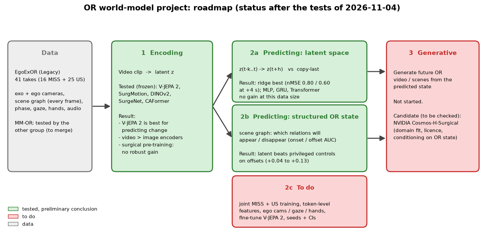

# World models for the OR: EgoExOR tests

Goal: an OR world model that (1) encodes OR video into a latent state, (2) predicts how that state evolves, and (3) generates the predicted future.
This repo contains the first tests of parts 1 and 2 on **EgoExOR** (Legacy release, 336×336). The same tests are being run on MM-OR by another group; both are compared in the project meeting.



*Green = tested, preliminary conclusion. Red = to do. Figure source: `scripts/make_roadmap.py`.*

## Status and conclusions (tests run 2026-11-04)

| Stage | Tested | Preliminary conclusion |
|---|---|---|
| **1 Encoding** | 5 frozen encoders: V-JEPA 2, SurgMotion (video); DINOv2, SurgeNet, CAFormer (image) | **V-JEPA 2** is the best encoder for predicting change. Video > image encoders; surgical pre-training gives no robust gain |
| **2a Predicting: latent space** | copy-last, ridge, MLP, GRU, Transformer on V-JEPA 2 latents | **Ridge is best**; MLP / GRU / Transformer give no gain at this data size |
| **2b Predicting: structured OR state** | which scene-graph relations will appear / disappear (+1 s, +4 s) | The latent beats privileged controls on "disappear" events; the predictor class makes little difference |
| **3 Generative** | not started | Candidate to check: NVIDIA Cosmos-H-Surgical (image / text → future video; trained on surgical-robot video, so OR domain fit, licence and conditioning on OR state are open) |

### Metrics (what they tell us)
* **Latent nMSE** = error of the predicted future latent / error of "nothing changes" (copy-last). < 1 means the latent change is predictable. Caveat: smoother latents get a lower nMSE without carrying more semantics.
* **Event AUC** (onset / offset) = for each scene-graph relation, can the model rank which will *appear* (absent now) or *disappear* (present now) at t+h? 0.5 = chance. **Controls** use privileged information and no encoder: the true current scene graph + position in the take + phase. Beating them means the latent contains information about the future that the current state does not.
* Protocol everywhere: leave-one-take-out or 5-fold **by take** (a take is never in train and test). Clip = 16 frames (~4 s), one per second.

### 1. Encoder comparison (mean over cameras)
| | scene-graph AUC at +4 s (MISS / US) | latent nMSE +4 s (MISS / US) | offset AUC +4 s (MISS / US) | onset AUC +4 s (MISS / US) |
|---|---|---|---|---|
| DINOv2 (image) | 0.832 / 0.874 | 1.16 / 0.84 | 0.586 / 0.655 | 0.799 / 0.830 |
| SurgeNet (image, surgical) | 0.828 / 0.863 | 1.03 / 0.80 | 0.563 / 0.645 | 0.793 / 0.807 |
| CAFormer (image, ImageNet) | 0.826 / 0.864 | 1.06 / 0.86 | 0.582 / 0.639 | 0.785 / 0.817 |
| **V-JEPA 2 (video)** | **0.875 / 0.914** | **0.84** / 0.60 | **0.662 / 0.739** | **0.844 / 0.874** |
| SurgMotion (video, surgical) | 0.839 / 0.898 | 0.89 / **0.54** | 0.615 / 0.712 | 0.805 / 0.849 |

* V-JEPA 2 is first in 14 of 16 scene-graph / nMSE / event columns (evaluated at +1 s and +4 s; the two exceptions are the Ultrasound nMSE, where SurgMotion is first). Its lead over SurgMotion is small (~0.03–0.05 AUC) and has no confidence interval; its lead over the size-matched image encoder DINOv2 is 0.07–0.08 offset AUC in both procedures (up to 0.13 over the other image encoders).
* Video encoders see 16 frames jointly, image encoders frame by frame; "video > image" therefore means "temporal input helps for predicting change". It does **not** show for phase recognition (image encoders are equal or better there).
* **Surgical pre-training:** SurgeNet − ImageNet CAFormer phase accuracy +0.025 (95 % CI [0.004, 0.055]) on MISS, −0.007 on Ultrasound; SurgMotion − V-JEPA 2 −0.003 (CI [−0.033, 0.024]) on MISS, −0.010 on Ultrasound. The SurgMotion − V-JEPA 2 sign flips with the camera. No robust benefit, and SurgMotion weights are gated, so V-JEPA 2 (public) is the choice.

### 2a. Latent-space prediction (V-JEPA 2, all cameras pooled, 5-fold by take)
Predictors: `ridge` (linear, last clip), `mlp1` (MLP, last clip), `mlp8` (MLP, 8 clips), `gru8` (GRU, 8 clips), `tf8` (2-layer Transformer, 8 clips); history 8 s, one seed, fixed hyper-parameters. nMSE at +1 s / +4 s:

| predictor | MISS | Ultrasound |
|---|---|---|
| copy-last | 1.00 / 1.00 | 1.00 / 1.00 |
| **ridge** | **0.91 / 0.80** | **0.76 / 0.60** |
| mlp1 | 0.96 / 0.81 | 0.81 / 0.63 |
| mlp8 | 1.00 / 0.86 | 0.96 / 0.71 |
| gru8 | 1.02 / 0.88 | 0.82 / 0.68 |
| tf8 | 1.09 / 0.98 | 0.80 / 0.65 |

Longer history and bigger models are slightly worse (over-fitting at 16 / 25 takes). The bottleneck is more likely the information in one pooled vector per clip and the amount of data than the predictor class.

### 2b. Structured OR state: scene-graph event prediction (V-JEPA 2, all cameras pooled)
Onset AUC / offset AUC at +1 s / +4 s (`controls` = true current scene graph + position in take + phase):

| predictor | MISS onset | MISS offset | Ultrasound onset | Ultrasound offset |
|---|---|---|---|---|
| controls | 0.82 / 0.85 | 0.59 / 0.61 | 0.85 / 0.88 | 0.63 / 0.65 |
| ridge | 0.85 / 0.83 | 0.71 / 0.65 | 0.87 / 0.87 | 0.76 / 0.73 |
| mlp1 | 0.86 / 0.84 | 0.69 / 0.65 | 0.90 / 0.90 | 0.75 / 0.74 |
| mlp8 | 0.84 / 0.82 | 0.67 / 0.67 | 0.89 / 0.88 | 0.72 / 0.72 |
| gru8 | 0.83 / 0.81 | 0.68 / 0.67 | 0.87 / 0.87 | 0.74 / 0.72 |
| tf8 | 0.86 / 0.84 | 0.69 / 0.71 | 0.86 / 0.88 | 0.72 / 0.72 |

* "Disappear" events are where the latent adds information (+0.04 to +0.13 over the controls); "appear" events are mostly explained by the current graph and the timing.
* All predictors are within ~0.03 AUC of each other, inside the noise of one seed and 16 / 25 takes. These numbers are the baseline a learned world-model predictor has to beat.
* Video latents are smooth: their displacement does not track scene-graph change (Spearman ≈ 0 on MISS, ~0.1 on Ultrasound), image latents' does (0.13–0.30). A world model on video latents needs a dedicated event head, not a latent-difference threshold.

### Other findings that affect the design
* **Cameras:** the camera matters more than the encoder for phase recognition (spread 0.15 across cameras vs 0.06 across encoders). Best single cameras: MISS `microscope` and `external_1`; Ultrasound `or_light`. Concatenating cameras with a linear probe does **not** beat the best single camera, so use all cameras as separate training samples (as in 2a / 2b) or with a model that selects views, not by plain concatenation.
* **Phase recognition is saturated:** on Ultrasound phases 3-5 every encoder reaches ≥ 0.996 (phases 1 and 2 are the same stage, which capped the 5-class score at 0.76). Use event prediction, not phase accuracy, as the world-model benchmark.
* **Anomaly detection is not testable with the current labels:** anomalies are annotated per take, and the recording order alone separates nominal from anomalous takes (AUC 1.0); the detection scores are at chance. Needs anomaly timestamps.

## Next steps
1. Train on MISS + Ultrasound jointly (shared 37-entity / 23-relation vocabulary) and test transfer across procedures; all cameras as samples.
2. Replace the pooled clip vector with token-level V-JEPA 2 features; then retry GRU / Transformer predictors.
3. Add ego cameras, gaze and hand tracking as inputs / conditioning.
4. Fine-tune V-JEPA 2 instead of probing; repeat with 3–5 seeds and confidence intervals.
5. Generative stage: evaluate Cosmos-H-Surgical (or alternatives) for conditioning on the predicted OR state.
6. Align with the MM-OR group: same encoder, same metrics (latent nMSE vs copy-last, onset / offset AUC vs controls), take-level splits, cross-dataset transfer.

## Limits
* 41 takes only (16 MISS, 25 Ultrasound): wide uncertainty, no hyper-parameter tuning, one seed; differences below ~0.03 AUC are not conclusive.
* Frozen encoders with simple predictors: these are baselines, not a world model.
* Scene-graph events come from sparse per-frame annotations sampled once per second.
* Not tested: ego cameras, gaze, hands, audio, point clouds, the Ultrasound screen stream, SurgMotion-G.

## EgoExOR data (what we have and what can be used)
* **41 takes** (one take = one continuous 1–4 min recording): **MISS** 16 takes (4 phases), **Ultrasound** 25 takes (5 phases); 94 min, 84,553 frames at 15 FPS, simulated procedures.
* **Cameras:** MISS `external_1..5` + `microscope` (+ ego cameras); Ultrasound `simstation`, `or_light` (+ ego), and `external_1..5` + an `ultrasound` screen stream only in 18 takes (phases 3–5). `external_*` frames are stored uncorrected; `egoexor_io.to_rgb` applies the official colour LUT.
* **Labels:** scene graph on every frame (37 entities / 23 relations, sparse: 3–9 triplets per frame), phase per take, scripted anomalies per take (nominal takes are always the first ones of a phase).
* **Other modalities:** eye gaze, hand tracking, audio, downsampled point cloud, camera calibration.
* Official splits are by take and have gaps (MISS phase 4 has no test take); all tests here use cross-validation by take instead.

## Reproduce
```powershell
uv venv --python 3.11 .venv
uv pip install --python .venv\Scripts\python.exe torch torchvision --index-url https://download.pytorch.org/whl/cu128   # cu128 is required for the RTX 5080
uv pip install --python .venv\Scripts\python.exe -r requirements.txt
.venv\Scripts\python.exe -m ipykernel install --user --name wm-or
git clone --depth 1 https://github.com/ardamamur/EgoExOR third_party\EgoExOR        # calibration, LUT, constants
git clone --depth 1 https://github.com/CAIR-HKISI/SurgMotion third_party\SurgMotion  # ViT code used for V-JEPA 2 / SurgMotion
powershell -ExecutionPolicy Bypass -File scripts\download_rest.ps1     # h5 files (~195 GB), resumable; also needs splits.h5 in data\raw
powershell -ExecutionPolicy Bypass -File scripts\run_pipeline.ps1      # features (resumable) + notebooks 01-04, ~2-3 h
```
Pipeline options: `-Procedure MISS`, `-Notebooks 04_predictor_comparison`, `-SkipExtract`, `-SkipNotebook`. Lint: `.venv\Scripts\ruff.exe check scripts notebooks`.

Checkpoints in `ckpts\` (DINOv2 comes from `timm`):

| Encoder | File | Source |
|---|---|---|
| V-JEPA 2 ViT-L | `vjepa2_vitl.pt` (5.1 GB) | `https://dl.fbaipublicfiles.com/vjepa2/vitl.pt` |
| SurgeNetXL CAFormer-S18 | `surgenetxl_teacher.pth` (93 MB) | `https://huggingface.co/TimJaspersTue/SurgeNetModels/resolve/main/SurgeNetXL_checkpoint_epoch0050_teacher.pth` |
| CAFormer-S18 ImageNet-1k | `caformer_s18_in1k.pth` (105 MB) | `https://huggingface.co/sail/dl/resolve/main/caformer/caformer_s18.pth` |
| SurgMotion-L | `SurgMotion-vitl.pt` (1.2 GB) | `hf download CAIR-HKISI/SurgMotion SurgMotion-vitl.pt --local-dir ckpts` (gated; `hf auth login`) |

### Layout
| Path | Purpose |
|---|---|
| `notebooks/00_egoexor_overview.py` | dataset overview (structure, takes, phases, anomalies, one example per camera / modality) |
| `notebooks/01_probe_and_temporal.py` | per encoder × camera: phase / scene-graph probes, latent prediction vs copy-last, paired pre-training test |
| `notebooks/02_dynamics_and_anomaly.py` | event prediction with controls, latent motion vs change, anomaly test, camera fusion, MLP vs ridge |
| `notebooks/03_synthesis.py` | encoder × camera heatmaps, camera vs encoder effect, pooled pre-training test |
| `notebooks/04_predictor_comparison.py` | V-JEPA 2, all cameras pooled: copy-last / ridge / MLP / GRU / Transformer (tables 2a, 2b) |
| `scripts/` | `egoexor_io.py` (HDF5 reading, LUT, anomaly table), `probe_utils.py` (shared loaders / probes), `extract_features.py` (frozen features, shared camera read), `download_*`, `run_pipeline.ps1`, `make_roadmap.py` |
| `outputs/` | figures and result tables of the notebooks (`overview`, `probe`, `dynamics`, `synthesis`, `predictors`) |

The `.py` notebooks (jupytext percent format) are the source of truth; executed `.ipynb` files are generated as `<name>_<procedure>.ipynb`. `data/`, `features/`, `ckpts/`, `third_party/`, `outputs/` are not tracked.
