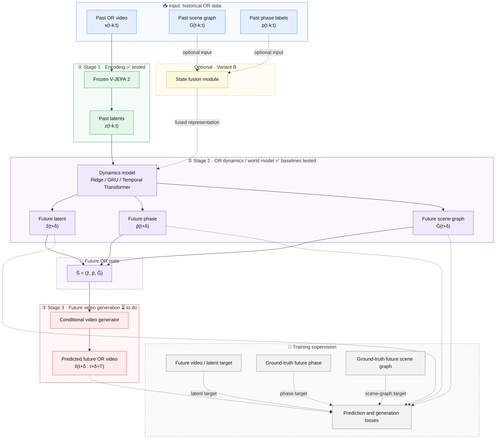

# World models for the OR: EgoExOR tests

Goal: an OR world model that (1) encodes OR video into a latent state, (2) predicts how that state evolves, and (3) generates the predicted future.
This repo contains the first tests of stages 1 and 2 on **EgoExOR** (Legacy release, 336×336). The same tests are being run on MM-OR by another group; both are compared in the project meeting.

**Contents:** [Architecture](#proposed-architecture) · [V-JEPA feasibility](#v-jepa-feasibility-tests) · [Earlier results](#results-summary-tests-run-2026-11-04) · [Detailed results](#detailed-results) · [Next steps](#next-steps) · [Limits](#limits) · [Data](#egoexor-data) · [Reproduce](#reproduce)

## Proposed architecture



* **Variant A (main line):** the dynamics model takes **video latents only**; phase and scene-graph labels are only supervision targets for `p̂` and `Ĝ`.
* **Variant B (optional ablation):** a fusion module also feeds past scene graph and phase to the dynamics model. A vs B measures what structured past state adds to video.
* The "controls" in the results (true current scene graph + phase) are an evaluation baseline, not part of the model.

### Roadmap


*Green = tested, preliminary conclusion. Red = to do. Figure source: `scripts/make_roadmap.py`.*

## V-JEPA feasibility tests

**Question:** can frozen V-JEPA 2 provide a useful structured OR representation, and does it carry information for forecasting future scene states? This is an encoder feasibility study on EgoExOR, not a complete world model.

Scene-graph targets are the main semantic test here: phase is constant within each take, so predicting the same future phase would not demonstrate movement prediction.

### What inputs? What outputs?

Measured with the local V-JEPA 2 ViT-L checkpoint on real synchronized Ego / Exo clips:

| Step | Actual data / tensor |
|---|---|
| Stored video | One camera's 336 x 336 RGB frames, source rate 15 FPS; colour conversion uses the existing dataset loader |
| Sampling | 16 frames at indices `s + [0, 4, 8, ..., 60]`: first-to-last span **4 seconds**. Clip starts advance by 15 source frames, i.e. **one clip per second**, not one frame per second |
| Preprocessing | Pixels / 255, bicubic resize to 256 x 256, channel normalization with mean `[0.485, 0.456, 0.406]` and std `[0.229, 0.224, 0.225]` |
| Encoder input | Floating-point pixel tensor **`[B, 3, 16, 256, 256]`**; no graph, text, phase, gaze or hand-tracking input |
| Inside the encoder | A tubelet is **2 sampled frames x 16 x 16 pixels**, not an extra input. There are `8 x 16 x 16 = 2048` tokens |
| Encoder output | **`[B, 2048, 1024]`** latent tokens; not triplets, text, images or future video |
| Features used in these tests | Spatial average -> **`[B, 8, 1024]`**; temporal average -> **`[B, 1024]`** |
| Structured output | Mean of synchronized camera feature vectors -> fitted ridge head -> triplet scores -> validation-selected threshold -> a **set of `subject | relation | object` triplets** |

`B` is the batch size. These are the tested settings, not a claim that V-JEPA only supports 16-frame clips. Higher sampling FPS at fixed frame count reduces the time span; its effect on recognition / forecasting has **not** been ablated here.

The I/O check also saves the 16 actual sampled frames for one Ego and one Exo clip, finite-value checks, latency and peak allocated GPU memory in `outputs/feasibility/io/`. The warmed batch-one preprocessing + encoding time was about **70 ms/clip** on the RTX 5080; this excludes disk reading, camera colour conversion and downstream decoding, and is not end-to-end throughput.

### Evaluation protocol

* **Separate Ego and Exo heads, and separate MISS / Ultrasound runs.** Within each group, use **all available synchronized room cameras** with uniform feature averaging, not cameras treated as independent test examples. No cross-camera holdout or test-label-based camera selection. The ultrasound **screen** stream is excluded.
* **Exo:** MISS uses `external_1..5` + `microscope`; Ultrasound uses `or_light` + `simstation`, adding `external_1..5` in the 18 takes that contain them. **Ego:** MISS uses `head_surgeon`, `assistant`, `circulator`, `anesthetist`; Ultrasound uses `head_surgeon` + `assistant`, adding `circulator` in its 7 available takes.
* **Blank input handling:** a camera can be listed in a take while some of its frames are entirely zero (observed in the actual Ego input check). Use a camera for a clip only when all 16 sampled raw frames are nonzero; normalize the average over the remaining usable cameras. Require at least one usable camera in **each** group so Ego / Exo are evaluated at identical timestamps. This is an input-validity check, not a learned camera priority or a guarantee that a relation is visible.
* **Causal clock:** `t` is the **last input frame**. Decode the graph at `t`, `t+1s`, and `t+4s` using only the clip ending at `t`. Use the same eligible clips for all horizons.
* **Missing annotation frames are not empty graphs.** Exclude a clip if any required target annotation is absent, and report exclusions per take in `coverage.csv`. Do not interpolate labels.
* **Five outer folds by take**, with a separate take-level validation subset inside each fold. Vocabulary, feature scaling and ridge fitting use training takes only; per-horizon thresholds maximize validation micro-F1. No test tuning, no refit on validation, no frequency-based removal of rare triplets.
* **Baselines:** DINOv2 on the same frames / cameras (existing 224px image setup versus V-JEPA's 256px); a training-frequency predictor with no video; each encoder's predicted-current-graph persistence; and **GT graph persistence**, explicitly privileged rather than a deployable method.
* **Metrics:** full-triplet precision / recall, micro- and macro-F1, exact graph match, triplet Recall@5/10 and mean Recall@5/10, plus per-relation and per-triplet errors. Unseen test triplets count as false negatives. `mAP_known_fold_mean` covers only training-vocabulary classes supported in a test fold, not the entire graph vocabulary.
* **Change prediction:** onset / offset AUC conditions on the true current relation state for **evaluation only**, using known triplets with at least 10 events and 10 non-events per fold. Eligible-class counts are reported; this is not event-detection F1.
* **Uncertainty:** 2,000 paired bootstrap resamples of held-out takes for F1 and model differences. These are descriptive intervals over this small dataset, not independent training-seed trials.
* **Inspectable outputs:** `predictions.jsonl` contains the actual predicted and GT triplet sets, missing / extra triplets, ranked scores, cameras, fold and input / target frame indices. Ridge scores are **not calibrated probabilities**. Notebook 05 shows quantitative results and preselected graph examples.

This tests **closed-vocabulary triplet-set generation**. It does not localize objects or generate previously unseen subject/relation/object combinations. It is a useful lower-bound readout of frozen features, not a ceiling on V-JEPA with token-level decoding or fine-tuning. Both view groups are scored against the **same room-level GT graph**, without visibility-specific labels; an Ego camera is not guaranteed to see every annotated relation. The annotations do not supply a global/local relation partition, so no such partition is invented.

### Results (2026-11-12)

All four runs completed: **16 MISS takes / 1,299 timestamps** and **25 Ultrasound takes / 3,856 timestamps**, with identical evaluated timestamps for Ego and Exo. After requiring room for the +4s target, 48 / 125 candidate timestamps were excluded for missing annotations or unusable inputs (reason counts can overlap). All required camera features and raw-frame validity masks are cached.

**Current scene graph, at the last observed frame:**

| Procedure | Views | V-JEPA micro-F1 | DINOv2 micro-F1 | Frequency micro-F1 | V-JEPA macro-F1 | Exact graph match |
|---|---|---|---|---|---|---|
| MISS | Exo | **0.782** | 0.748 | 0.609 | 0.287 | 15.2% |
| MISS | Ego | **0.801** | 0.792 | 0.609 | 0.300 | 17.3% |
| Ultrasound | Exo | **0.848** | 0.834 | 0.681 | 0.236 | 21.9% |
| Ultrasound | Ego | **0.863** | 0.849 | 0.681 | 0.237 | 27.6% |

V-JEPA beats the nonvisual frequency baseline in every group. Its current-state micro-F1 advantage over DINOv2 has a positive paired 95% interval in three groups; **MISS Ego is inconclusive** (+0.0094, CI [-0.0031, 0.0225]). It is not uniformly best on every metric: MISS Ego macro-F1 is 0.300 for V-JEPA versus 0.312 for DINOv2.

**Future scene graph, four seconds AFTER the last observed frame:**

| Procedure | Views | V-JEPA future micro-F1 | Copy predicted current graph | Paired F1 gain [95% CI] |
|---|---|---|---|---|
| MISS | Exo | 0.712 | 0.713 | -0.0005 [-0.0164, 0.0140] |
| MISS | Ego | 0.732 | 0.731 | +0.0004 [-0.0126, 0.0135] |
| Ultrasound | Exo | 0.814 | 0.795 | **+0.0182 [0.0116, 0.0262]** |
| Ultrasound | Ego | 0.816 | 0.799 | **+0.0172 [0.0116, 0.0236]** |

Displayed F1 values are rounded; differences use unrounded scores. At +1s, gains over predicted-graph persistence are small (0.0002-0.0061), with a positive interval only for Ultrasound Ego. The +1s V-JEPA onset / offset AUC ranges are 0.823-0.881 / 0.741-0.759 on eligible known triplets: there is useful change-related ranking information, but it does not automatically translate into a large full-graph F1 gain.

**Feasibility verdict:** V-JEPA is a promising **OR encoder with a learned structured readout**, for both view groups. It is **not yet a reliable complete scene-graph generator or a validated world model**:

* Micro-F1 is reasonably high, but macro-F1 and exact graph match are much lower. Common relations dominate; rare triplets remain a major weakness. Training vocabularies cover about 95.7% / 98.3% of current test-label occurrences, not all possible combinations.
* Forecasting improves over persistence on Ultrasound at +4s, but **not convincingly on MISS**. This supports further dynamics experiments rather than claiming the prediction problem is solved.
* These are held-out takes within the same simulated procedures / room. Unseen procedures, new rooms, real surgery, visual consistency and future-video quality have **not** been validated.
* The next useful step is a stronger token-level / relation-aware readout and causal event prediction, keeping these baselines. No prompt pipeline or video generator was introduced.

Full scores, per-relation errors, take splits, paired intervals and **61,860 saved V-JEPA / DINOv2 graph predictions** are in `outputs/feasibility/`. The saved predictions were checked for timestamp causality, fold membership, vocabulary membership, uniqueness and agreement with the reported F1. Both notebook reports executed successfully; 14 protocol / input-handling regression tests pass.

Reports: [MISS](notebooks/05_vjepa_feasibility_MISS.ipynb) · [Ultrasound](notebooks/05_vjepa_feasibility_Ultrasound.ipynb) · [notebook source](notebooks/05_vjepa_feasibility.py). Executed notebooks and result files are generated locally, not tracked.

### Reproduce the feasibility tests

```powershell
.venv\Scripts\python.exe scripts\check_vjepa_io.py
.venv\Scripts\python.exe scripts\extract_multiview_features.py
.venv\Scripts\python.exe scripts\evaluate_triplets.py
.venv\Scripts\python.exe -m unittest discover -s scripts -p test_evaluate_triplets.py -v
powershell -ExecutionPolicy Bypass -File scripts\run_pipeline.ps1 -SkipExtract -Notebooks 05_vjepa_feasibility
```

Feature extraction completes missing V-JEPA / DINOv2 files for both view groups, reuses validated existing files, caches raw-frame validity under `data/cache/clip_validity/` and reads camera blocks together. Evaluation can be restricted with `--procedures MISS` or `--views ego`. Results are stored under `outputs/feasibility/<procedure>_<view>/`; the visualization notebook requires a completed `protocol.json` rather than displaying a partial run.

## Results summary (tests run 2026-11-04)

**Historical exploratory results below, not the causal feasibility protocol above.** The old graph probes use clip-centre labels, while the video contains another two seconds after that centre: their "+1s" target is inside the observed clip, and "+4s" is only two seconds beyond its end. Overlapping future latent clips also share observed footage. Notebook 04 additionally scales features before splitting, and the old graph helpers interpret absent annotation frames as empty graphs. Keep these tables as historical diagnostics; do **not** treat them as validated causal forecasting results or compare their AUC directly with the new full-graph F1.

| Stage | Tested | Preliminary conclusion |
|---|---|---|
| **1 Encoding** | 5 frozen encoders: V-JEPA 2, SurgMotion (video); DINOv2, SurgeNet, CAFormer (image) | **V-JEPA 2** led most reported columns; the full ranking needs a causal-protocol rerun |
| **2a Predicting: latent space** | copy-last, ridge, MLP, GRU, Transformer on V-JEPA 2 latents | **Ridge had the lowest nMSE** in this one-seed comparison; the reason has not been isolated |
| **2b Predicting: structured OR state** | which scene-graph relations will appear / disappear (+1 s, +4 s) | Video features helped offset-ranking relative to the listed controls; no consistent predictor winner |
| **3 Generative** | not started | Candidate to check: NVIDIA Cosmos-H-Surgical (image / text → future video; trained on surgical-robot video, so OR domain fit, licence and conditioning on OR state are open) |

## Detailed historical results

### Metrics (what they tell us)
* **Latent nMSE** = error of the predicted future latent / error of "nothing changes" (copy-last). < 1 beats copy-last for the reported representation and target window; it does not demonstrate semantic fidelity.
* **Event AUC** (onset / offset) = for each scene-graph triplet, can the model rank which will *appear* (absent now) or *disappear* (present now) at t+h? 0.5 = chance. **Controls** use privileged information and no encoder: the true current scene graph + position in the take + phase. A better score than these controls is not, by itself, evidence of causal future information.
* Historical protocol: leave-one-take-out or 5-fold **by take** (a take is never in train and test), subject to the preprocessing / timestamp caveats above. Clip = 16 subsampled frames spanning 4 s; one clip starts per second.

### 1. Encoder comparison (mean over cameras)
| | scene-graph AUC at +4 s (MISS / US) | latent nMSE +4 s (MISS / US) | offset AUC +4 s (MISS / US) | onset AUC +4 s (MISS / US) |
|---|---|---|---|---|
| DINOv2 (image) | 0.832 / 0.874 | 1.16 / 0.84 | 0.586 / 0.655 | 0.799 / 0.830 |
| SurgeNet (image, surgical) | 0.828 / 0.863 | 1.03 / 0.80 | 0.563 / 0.645 | 0.793 / 0.807 |
| CAFormer (image, ImageNet) | 0.826 / 0.864 | 1.06 / 0.86 | 0.582 / 0.639 | 0.785 / 0.817 |
| **V-JEPA 2 (video)** | **0.875 / 0.914** | **0.84** / 0.60 | **0.662 / 0.739** | **0.844 / 0.874** |
| SurgMotion (video, surgical) | 0.839 / 0.898 | 0.89 / **0.54** | 0.615 / 0.712 | 0.805 / 0.849 |

* V-JEPA 2 is first in 14 of 16 scene-graph / nMSE / event columns (evaluated at +1 s and +4 s; the two exceptions are the Ultrasound nMSE, where SurgMotion is first). Its lead over SurgMotion is small (~0.03–0.05 AUC) and has no confidence interval; its lead over the size-matched image encoder DINOv2 is 0.07–0.08 offset AUC in both procedures (up to 0.13 over the other image encoders).
* Video encoders see 16 frames jointly, image encoders frame by frame. The observed ranking motivates testing temporal features, but does not isolate temporal processing from differences in architecture and pre-training. Image encoders are equal or better on phase recognition.
* **Surgical pre-training:** SurgeNet − ImageNet CAFormer phase accuracy +0.025 (95 % CI [0.004, 0.055]) on MISS, −0.007 on Ultrasound; SurgMotion − V-JEPA 2 −0.003 (CI [−0.033, 0.024]) on MISS, −0.010 on Ultrasound. The SurgMotion − V-JEPA 2 sign flips with the camera. No robust benefit, and SurgMotion weights are gated, so V-JEPA 2 (public) is the choice.

### 2a. Latent-space prediction (V-JEPA 2, camera-clips pooled as samples, 5-fold by take)
Predictors: `ridge` (linear, last clip), `mlp1` (MLP, last clip), `mlp8` (MLP, 8 clips), `gru8` (GRU, 8 clips), `tf8` (2-layer Transformer, 8 clips); history of eight clips at one-second stride, one seed, fixed hyper-parameters. Each history belongs to one camera; different cameras are separate samples, not averaged features. nMSE at +1 s / +4 s:

| predictor | MISS | Ultrasound |
|---|---|---|
| copy-last | 1.00 / 1.00 | 1.00 / 1.00 |
| **ridge** | **0.91 / 0.80** | **0.76 / 0.60** |
| mlp1 | 0.96 / 0.81 | 0.81 / 0.63 |
| mlp8 | 1.00 / 0.86 | 0.96 / 0.71 |
| gru8 | 1.02 / 0.88 | 0.82 / 0.68 |
| tf8 | 1.09 / 0.98 | 0.80 / 0.65 |

Longer history and bigger models did not improve nMSE in this experiment. Overfitting, limited data, pooled representations and optimization are possible explanations, not established causes. The models also did not all receive the same history length, so the comparison does not isolate predictor class.

### 2b. Structured OR state: scene-graph event prediction (V-JEPA 2, camera-clips pooled as samples)
Onset AUC / offset AUC at +1 s / +4 s (`controls` = true current scene graph + position in take + phase):

| predictor | MISS onset | MISS offset | Ultrasound onset | Ultrasound offset |
|---|---|---|---|---|
| controls | 0.82 / 0.85 | 0.59 / 0.61 | 0.85 / 0.88 | 0.63 / 0.65 |
| ridge | 0.85 / 0.83 | 0.71 / 0.65 | 0.87 / 0.87 | 0.76 / 0.73 |
| mlp1 | 0.86 / 0.84 | 0.69 / 0.65 | 0.90 / 0.90 | 0.75 / 0.74 |
| mlp8 | 0.84 / 0.82 | 0.67 / 0.67 | 0.89 / 0.88 | 0.72 / 0.72 |
| gru8 | 0.83 / 0.81 | 0.68 / 0.67 | 0.87 / 0.87 | 0.74 / 0.72 |
| tf8 | 0.86 / 0.84 | 0.69 / 0.71 | 0.86 / 0.88 | 0.72 / 0.72 |

* "Disappear" events are where the latent adds information (+0.04 to +0.13 over the controls); "appear" events are mostly explained by the current graph and the timing.
* Rankings vary by event metric; one-seed point estimates do not establish equivalence or a universal predictor winner. Use the corrected causal baseline above for new comparisons.
* Video latents are smooth: their displacement does not track scene-graph change (Spearman ≈ 0 on MISS, ~0.1 on Ultrasound), image latents' does (0.13–0.30). A world model on video latents needs a dedicated event head, not a latent-difference threshold.

### Other findings that affect the design
* **Cameras:** in the historical phase-recognition experiment, scores varied more across cameras (spread 0.15) than encoders (0.06). Best single cameras there were MISS `microscope` and `external_1`, and Ultrasound `or_light`; the tested linear concatenation probe did not beat the best single camera. This motivates controlled fusion tests, not a general ranking of cameras for every relation. The new feasibility baseline uses all usable cameras within each view group.
* **Phase recognition is saturated:** on Ultrasound phases 3-5 every encoder reaches ≥ 0.996 (phases 1 and 2 are the same stage, which capped the 5-class score at 0.76). Use event prediction, not phase accuracy, as the world-model benchmark.
* **Anomaly detection is not testable with the current labels:** anomalies are annotated per take, and the recording order alone separates nominal from anomalous takes (AUC 1.0); the detection scores are at chance. Needs anomaly timestamps.

## Next steps

**Status: proposed ablations, not implemented or trained.** The completed results above remain the reference. The objective is better structured-state reconstruction and genuine future prediction, not making a Transformer beat Ridge for its own sake.

### Evidence versus hypotheses

* **Encoder choice:** V-JEPA is a promising candidate, not an established universal winner. The new causal evaluation compares it with DINOv2 and simple controls; CAFormer and SurgMotion have not been rerun under this protocol. Historical results cannot establish their ranking under the corrected protocol, and V-JEPA is not best on every current metric.
* **Predictor choice:** Ridge had the lowest pooled-latent prediction error in the historical small-data experiment, not a consistent win on every graph/event metric. GRU / Transformer have not yet been compared under the new protocol. The old GRU already received **eight consecutive clip vectors**; average pooling did not leave it with no temporal sequence.
* **Representation hypothesis:** global pooling removes explicit spatial layout and within-clip temporal indexing, but the pooled video features can still encode motion and semantics. Pooling, limited data, model capacity and optimization are possible explanations for the old results; none has been isolated as the cause.
* **Fusion hypothesis:** uniform averaging may hide camera identity and task-dependent usefulness, but may also regularize small-data training. The current pipeline averages **within each view group**, never Ego and Exo together. The historical predictor experiment instead pooled camera-clips as separate samples; cross-camera averaging cannot explain its GRU / Transformer ranking. A camera's usefulness for phase recognition does not establish its usefulness for every triplet.

Keep the encoder frozen initially, with **separate Ego / Exo heads and separate MISS / Ultrasound runs**. Preserve all usable cameras, masks and the causal take-level protocol. Do not simultaneously change representation, fusion and predictor class.

### 1. Isolate temporal pooling using existing features

The existing [feature extractor](scripts/extract_features.py) already saves both `feat: [N, 1024]` and `seq: [N, 8, 1024]`. The latter averages space only, retaining the eight tubelet-time positions within each four-second clip. It is not eight seconds of history and is distinct from the old predictor's eight-clip history.

Start with this controlled matrix, without extracting new video features:

| Within-camera representation | Uniform valid-camera fusion | Learned masked camera gate |
|---|---|---|
| Current pooled vector, represented as length-one sequence | Pooled / mean control | Isolates gating on pooled inputs |
| Existing eight-position `seq` | Isolates removal of temporal averaging | Tests their interaction |

Use the **same small trainable temporal readout and linear triplet head**, projection width, loss, tuning budget and take splits across these four variants. Train gating and decoding on training takes; select hyperparameters on validation takes. Keep the existing Ridge result as an additional reference, rather than attributing a gain over Ridge to gating when the decoder or loss also changed. Report parameter counts and use a capacity-matched mean-fusion control for an apparent gating gain.

### 2. Add spatial token readout, without immediately discarding the retained detail

For the tested encoder settings, native tokens can be reorganized as:

```text
one camera:   [B, 2048, 1024] -> [B, 8, 256, 1024]
camera group:                  [B, C, 8, 256, 1024]
```

Here, 8 is the number of temporal positions and 256 is the 16 x 16 spatial grid. Preserve the time/grid indices and camera identity. Compare the spatial-mean representation from step 1 with a **small learned spatial readout**, such as shared query slots attending to each camera's spatial tokens. A possible interface is `[B, C, 8, K, d]`, with a small number of state slots `K` and projected width `d`, chosen within the training/validation budget. Retain the temporal axis and compare with a matched mean-readout control before changing the dynamics model.

The goal is to preserve useful local structure, not to ban every form of compression. Do not flatten all cameras, spatial tokens and history into one large self-attention sequence by default. Also **do not average same-index image patches across cameras**: their spatial grids are not geometrically registered. Shared readout queries or cross-view attention must define the fusion representation rather than assuming patch correspondence.

**Causality caveat:** the encoder uses noncausal attention within the observed clip. A token at an early temporal position can contain information from later frames of that clip. Reshaping tokens does not create eight independent causal states; treat the representation as available at the **last input frame** and forecast only beyond that endpoint.

**Resource check:** each native-token camera-clip needs 4 MiB in FP16. The current 47,671 cached camera-clips would require about **186.2 GiB uncompressed**, excluding metadata and training overhead. Profile a training-only pilot first, then choose a bounded caching / readout strategy; do not silently replace the existing compact caches.

### 3. Make view weighting compatible with both representations

For the first ablation, let each camera supply `U: [B, C, L, d]`, where `L=1` for pooled input or `L=8` for `seq`. A lightweight scorer uses visual features and camera-ID/role embeddings to produce weights `w: [B, C, L]`:

```text
scores = MLP(camera features, camera identity)
weights = masked_softmax(scores, camera axis)
fused[b,l,:] = sum_c weights[b,c,l] * U[b,c,l,:]
```

Missing cameras and camera-clips with **any all-zero sampled frame** must receive zero weight; an all-masked group is excluded and reported, not converted into a fabricated state. For the later token readout, extend the gate to shared slots `[B, C, L, K, d]` and retain `[B, L, K, d]` after fusion instead of collapsing back to a single clip vector.

Compare **uniform weights, learned static per-camera weights and input-dependent weights** with the same decoder. The gate may adapt to visual evidence of the surgical stage, but **GT phase is not an inference input**; any GT-phase-conditioned variant is a separately labelled privileged control. Phase labels can group results afterward; auxiliary phase supervision would be a separate controlled ablation.

Plot weights by phase, relation and time together with availability masks. These plots describe the model's weighting, not proof of causal importance or clinical interpretability. Supplement them with controlled camera removal/masking and the static/uniform controls. Camera availability itself varies with phase in Ultrasound, so do not mistake missingness patterns for learned specialization. The main benchmark still uses all available cameras; removal tests are diagnostics, not a new cross-camera-holdout task.

### 4. Retry dynamics only after the representation / fusion controls

Compare Ridge / a small MLP on flattened features with GRU and a small temporal Transformer on the **same available history and targets**. Distinguish within-clip token time from history across clips, keep histories within a take, and use actual timestamps when validity filtering leaves gaps. Select configurations using training/validation takes only; do not choose the representation from outer-test scores and then reuse those scores as an untouched test.

Train current-graph and future-graph heads at `t`, `t+1s`, and `t+4s`, where `t` is the latest observed frame. First establish whether a new readout improves current-state decoding; an improvement there alone is not evidence that dynamics improved.

### 5. Evaluation and advancement criteria

* **Semantic state quality:** retain micro-/macro-F1, precision/recall, exact graph match, triplet Recall@K, per-relation errors and rare-triplet / unseen-combination coverage. Do not replace these with AUC alone.
* **Prediction:** compare future graphs with each method's own predicted-current-graph persistence, not just with the old Ridge numbers. Report onset/offset ROC-AUC and AP with eligible-class and event/non-event counts and, when producing event sets, event precision/recall/F1. Keep true-current-graph persistence explicitly privileged.
* **Latent nMSE is auxiliary:** compare predictors against copy-last using the **same fixed frozen target representation and target window**. A new token-space nMSE is not directly comparable to the old pooled-space nMSE. Define a future-only target clip, with its first frame after `t`, and report its start/end times; do not label an overlapping clip target as wholly future.
* **Reliability and cost:** preserve train-only vocabulary/scaling, take-disjoint validation, missing-input/annotation handling and identical evaluated timestamps. Use 3-5 seeds for trainable models, paired take-level intervals, parameter counts, memory and runtime. Ego and Exo still share room-level GT, not visibility-specific labels.
* **Decision:** retain a modification only if semantic reconstruction or causal forecasting improves reproducibly at acceptable cost. Lower latent error, plausible-looking attention weights or one favorable seed alone do not establish a better world model. No gain from tokens or gating is a useful result, not a reason to keep increasing model size.

Fine-tuning, frame-rate/clip-length/resolution ablations, joint-procedure training and held-out-procedure / MM-OR transfer remain later experiments. Future-video generation, visual-quality evaluation, gaze and hand tracking are deferred; they are not part of this proposed token/fusion ablation.

## Limits
* 41 takes only (16 MISS, 25 Ultrasound). Historical neural comparisons used one seed and fixed hyper-parameters; the new Ridge feasibility runs report take-bootstrap intervals, not neural-training seed uncertainty. Small score differences need uncertainty estimates, not a universal AUC cutoff.
* Frozen encoders with simple predictors: these are baselines, not a world model.
* Scene-graph events come from sparse per-frame annotations sampled once per second.
* The earlier notebooks 01-04 did not test ego cameras. The new feasibility protocol includes them separately. Gaze, hands, audio, point clouds, the Ultrasound screen stream and SurgMotion-G remain outside these tests.

## EgoExOR data
* **41 takes** (one take = one continuous 1–4 min recording): **MISS** 16 takes (4 phases), **Ultrasound** 25 takes (5 phases); 94 min, 84,553 frames at 15 FPS, simulated procedures.
* **Cameras:** MISS `external_1..5` + `microscope` (+ ego cameras); Ultrasound `simstation`, `or_light` (+ ego), and `external_1..5` + an `ultrasound` screen stream only in 18 takes (phases 3–5). `external_*` frames are stored uncorrected; `egoexor_io.to_rgb` applies the official colour LUT.
* **Labels:** frame-indexed scene graphs (37 entities / 23 relations, sparse: typically 3–9 triplets per annotated frame; some frame annotations are absent), phase per take, scripted anomalies per take (nominal takes are always the first ones of a phase).
* **Other modalities:** eye gaze, hand tracking, audio, downsampled point cloud, camera calibration.
* Official splits are by take and have gaps (MISS phase 4 has no test take); all tests here use cross-validation by take instead.

### Scene-graph vocabulary
A triplet is `subject | relation | object`, e.g. `head_surgeon | holding | curette`. The dataset defines **37 entities** and **23 relations**.
* **Entities (37):** people `head_surgeon, assistant, circulator, anaesthetist, patient`; instruments `forceps, curette, needle, syringe, scalpel, scissors, ultrasound_probe, instruments, unsterile instruments`; equipment and furniture `operating_table, operation_table, instrument_table, ultrasound_machine, ultrasound_screen, microscope, microscope_controller, microscope_eye, microscope_screen, health_monitor, anesthesia_equipment, bin, operating_room`; consumables and other `antiseptic, body_marker, cotton, dressing_material, gloves, herbal_disk, tissue_mark, tissue_paper, ultrasound_gel, vertebrae`.
* **Relations (23):** `anesthasing, applying, aspirating, checking, closeTo, controlling, cutting, disinfection, dressing, dropping, entering, holding, injecting, inserting, looking, lyingOn, manipulating, positioning, preparing, removing, scanning, touching, wearing`.

## Reproduce
```powershell
uv venv --python 3.11 .venv
uv pip install --python .venv\Scripts\python.exe torch torchvision --index-url https://download.pytorch.org/whl/cu128   # cu128 is required for the RTX 5080
uv pip install --python .venv\Scripts\python.exe -r requirements.txt
.venv\Scripts\python.exe -m ipykernel install --user --name wm-or
git clone --depth 1 https://github.com/ardamamur/EgoExOR third_party\EgoExOR        # calibration, LUT, constants
git clone --depth 1 https://github.com/CAIR-HKISI/SurgMotion third_party\SurgMotion  # ViT code used for V-JEPA 2 / SurgMotion
powershell -ExecutionPolicy Bypass -File scripts\download_rest.ps1     # h5 files (~195 GB), resumable; also needs splits.h5 in data\raw
powershell -ExecutionPolicy Bypass -File scripts\run_pipeline.ps1      # features (resumable) + notebooks 01-04, ~2-3 h
```
Pipeline options: `-Procedure MISS`, `-Notebooks 04_predictor_comparison`, `-SkipExtract`, `-SkipNotebook`. Lint: `.venv\Scripts\ruff.exe check scripts notebooks`.

### Checkpoints
Stored in `ckpts\` (DINOv2 comes from `timm`):

| Encoder | File | Source |
|---|---|---|
| V-JEPA 2 ViT-L | `vjepa2_vitl.pt` (5.1 GB) | `https://dl.fbaipublicfiles.com/vjepa2/vitl.pt` |
| SurgeNetXL CAFormer-S18 | `surgenetxl_teacher.pth` (93 MB) | `https://huggingface.co/TimJaspersTue/SurgeNetModels/resolve/main/SurgeNetXL_checkpoint_epoch0050_teacher.pth` |
| CAFormer-S18 ImageNet-1k | `caformer_s18_in1k.pth` (105 MB) | `https://huggingface.co/sail/dl/resolve/main/caformer/caformer_s18.pth` |
| SurgMotion-L | `SurgMotion-vitl.pt` (1.2 GB) | `hf download CAIR-HKISI/SurgMotion SurgMotion-vitl.pt --local-dir ckpts` (gated; `hf auth login`) |

### Layout
| Path | Purpose |
|---|---|
| `notebooks/00_egoexor_overview.py` | dataset overview (structure, takes, phases, anomalies, one example per camera / modality) |
| `notebooks/01_probe_and_temporal.py` | per encoder × camera: phase / scene-graph probes, latent prediction vs copy-last, paired pre-training test |
| `notebooks/02_dynamics_and_anomaly.py` | event prediction with controls, latent motion vs change, anomaly test, camera fusion, MLP vs ridge |
| `notebooks/03_synthesis.py` | encoder × camera heatmaps, camera vs encoder effect, pooled pre-training test |
| `notebooks/04_predictor_comparison.py` | V-JEPA 2, all cameras pooled: copy-last / ridge / MLP / GRU / Transformer (tables 2a, 2b) |
| `notebooks/05_vjepa_feasibility.py` | measured encoder I/O, separate Ego / Exo triplet-set results, paired comparisons, relation errors and graph examples |
| `scripts/check_vjepa_io.py`, `scripts/extract_multiview_features.py`, `scripts/evaluate_triplets.py` | real-input I/O checks, resumable all-camera frozen features, causal take-held-out triplet evaluation |
| `scripts/` | `egoexor_io.py` (HDF5 reading, LUT, anomaly table), `probe_utils.py` (shared loaders / probes), `extract_features.py` (frozen features, shared camera read), `download_*`, `run_pipeline.ps1`, `make_roadmap.py` |
| `outputs/` | figures and result tables (`overview`, `probe`, `dynamics`, `synthesis`, `predictors`, `feasibility`); feasibility also includes prediction JSONL and split / coverage records |

The `.py` notebooks (jupytext percent format) are the source of truth; executed `.ipynb` files are generated as `<name>_<procedure>.ipynb`. `data/`, `features/`, `ckpts/`, `third_party/`, `outputs/` are not tracked.
